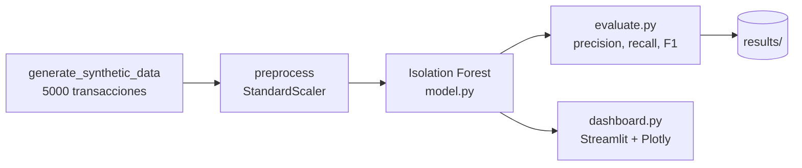

# Arquitectura

| Módulo | Funciones | Qué hace |
|---|---|---|
| `src/data_processing.py` | `generate_synthetic_data`, `preprocess` | Datos con 2 % de anomalías inyectadas y escalado de variables |
| `src/model.py` | `train_isolation_forest`, `score_anomalies`, `save_model`, `load_model` | Entrena, puntúa (1 = anómalo) y guarda el modelo |
| `src/evaluate.py` | `compute_metrics`, `plot_score_distribution`, `plot_flagged_scatter` | Métricas contra la etiqueta real y gráficas |
| `src/run_pipeline.py` | `main` | Corre todo sin interfaz y guarda en `results/` |
| `src/dashboard.py` | — | Dashboard de Streamlit para explorar los resultados |

## Decisiones

- **Datos sintéticos con etiqueta:** permiten medir precision y recall de un modelo no supervisado, cosa que con datos reales sin etiqueta no se puede.
- **Isolation Forest:** no necesita ejemplos etiquetados para entrenar y escala bien; `contamination` se iguala a la tasa de anomalías inyectada.
- **Semilla fija (42):** resultados reproducibles en el pipeline y en las pruebas.

## Pruebas

`tests/` verifica el tamaño y la tasa de anomalías de los datos, el escalado y que el modelo detecte la mayoría de anomalías inyectadas.
